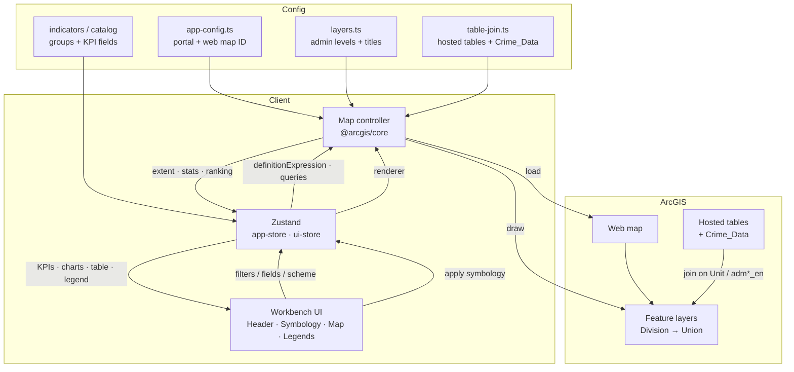
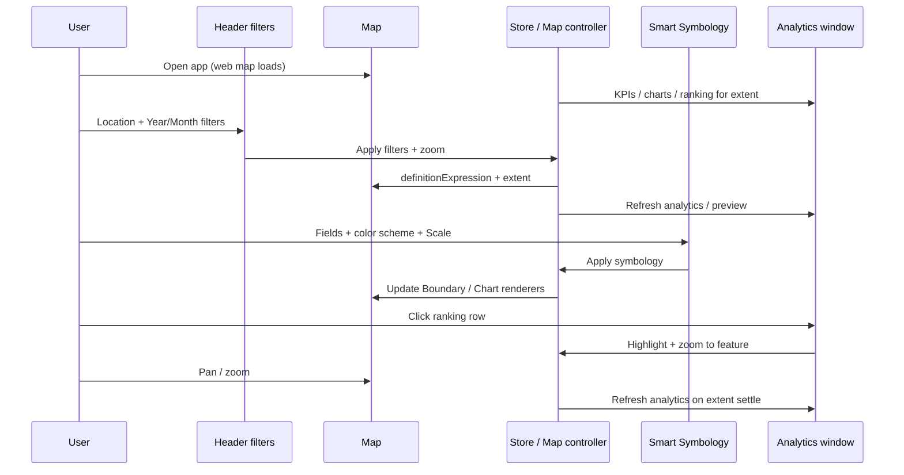

# Insight Hub Dashboard — Bangladesh Police

Map-centric web application for Bangladesh Police crime and administrative intelligence.  
Built with **ArcGIS Maps SDK for JavaScript**, **Calcite Design System**, and a React workbench layout similar to ArcGIS Dashboards / Experience Builder.

**Live demo:** [https://bangladesh-police.vercel.app/](https://bangladesh-police.vercel.app/)  
**Repository:** [https://github.com/aunkuresri/Bangladesh-Police](https://github.com/aunkuresri/Bangladesh-Police)

---

## Features

| Area | Capabilities |
|------|----------------|
| **Header** | Branding (Insight Hub Dashboard · Bangladesh Police); hierarchical **location filters** (Division → Unit → District → Upazila → Union) with cascade; **Year / Month** date filters; **Add Data** (CSV attribute update); optional auth |
| **Left panel – Smart Symbology** | Indicator groups & fields (Crimes and related); color schemes; layer group (**Boundary** / **Chart**); independent **Scale** settings per group; Apply / Reset |
| **Map** | ArcGIS web map; zoom-driven admin level visibility; boundary popups; Map KPI bar; smart symbology legend |
| **Right panel – Legends** | Applied boundary / chart symbology legends |
| **Analytics window** | KPI cards, composition / trend charts, ranking table (row click → highlight / zoom), map preview that follows filters |
| **Data update** | CSV upload to feature layers (Append or Append and Replace) by admin level and selected indicator fields |

**Data model:** Indicator values come from **hosted tables** (Division / District / Upazila / Union) and **Crime_Data**, joined to feature layers on Unit + `adm*_en` (and Custom_Unit_Code for ranges such as Barishal). Filters: Unit, Year, Month — when Year/Month are unset, values are aggregated across all periods by Unit.

**Crimes trend fields (examples):** murder, robbery, dacoity, theft, burglary, woman_child_repression, kidnapping, police_assault, riot, speedy_trial (no `total_cases` in trend series).

---

## Technology

| Layer | Stack |
|-------|--------|
| UI | React 19, TypeScript, Tailwind CSS 4 |
| Design system | [Calcite Components](https://developers.arcgis.com/calcite-design-system/) (`@esri/calcite-components`) |
| Maps | [ArcGIS Maps SDK for JavaScript](https://developers.arcgis.com/javascript/) 4.33 (`@arcgis/core`) |
| State | Zustand (`app-store`, `ui-store`) |
| Routing | TanStack Router |
| Charts | Recharts |
| Build | Vite 8 |
| Deploy | Vercel (static SPA) |

**Portal / web map** (configurable in `src/config/app-config.ts`):

- Portal: `https://dev.esribangladesh.com/portal`
- Web map ID: `07d336b23d78499ebc4b42759232de67`
- OAuth app ID: `RftqYktNS3HSPyy2`

---

## Prerequisites

- **Node.js** 20+ (LTS recommended)
- **npm** 10+ (comes with Node)
- Network access to the ArcGIS portal / feature services used by the web map

---

## Installation

```bash
# Clone
git clone https://github.com/aunkuresri/Bangladesh-Police.git
cd Bangladesh-Police

# Install dependencies
npm install

# Start development server (http://localhost:8080)
npm run dev
```

### Production build

```bash
npm run build
npm run preview   # optional local preview of the build
```

### Useful scripts

| Command | Description |
|---------|-------------|
| `npm run dev` | Vite dev server on port **8080** |
| `npm run build` | Production build |
| `npm run preview` | Preview production build |
| `npm run typecheck` | TypeScript check |
| `npm run lint` | ESLint |
| `npm run format` | Prettier |

### Configuration

Edit `src/config/app-config.ts` (or set `window.APP_CONFIG` at runtime):

```ts
export const APP_CONFIG = {
  portalUrl: "https://dev.esribangladesh.com/portal",
  webmapId: "07d336b23d78499ebc4b42759232de67",
  oauthAppId: "RftqYktNS3HSPyy2",
  title: "Insight Hub Dashboard",
  subtitle: "Bangladesh Police",
  defaultAnalyticsGroup: "Crimes",
  defaultMetric: "total_cases",
  rankingRows: 40,
  chartMaxIndicators: 10,
  // ...
};
```

| File | Purpose |
|------|---------|
| `src/config/app-config.ts` | Portal, web map ID, branding, defaults |
| `src/config/indicators.ts` / catalog | Indicator groups, KPI fields, composition / trend charts |
| `src/config/layers.ts` | Admin levels, layer titles, scale ranges |
| `src/config/symbology-schemes.ts` | Color schemes, bivariate / ternary / choropleth palettes |
| `src/lib/gis/table-join.ts` | Join of hosted tables (and Crime_Data) to feature layers |

---

## Layout (current workbench)

```
┌─────────────────────────────────────────────────────────────┐
│  Header: Brand · Location + date filters · Add Data         │
├──────────────┬──────────────────────────────┬───────────────┤
│ Smart        │  Map KPI bar                 │  Legends      │
│ Symbology    │  Map (web map + tools)       │  (right)      │
│ (left)       │  Smart legend portal         │               │
└──────────────┴──────────────────────────────┴───────────────┘
     Analytics window (overlay) · Data update modal (overlay)
```

1. **Header** – Title/subtitle, cascading location filters (Division → Unit → District → Upazila → Union), Year/Month, Add Data.
2. **Left panel** – Smart Symbology (fields, scheme, Scale gear, Boundary/Chart, Apply/Reset).
3. **Map** – Web map, extent/filter sync, KPI strip, legend.
4. **Right panel** – Applied symbology legends.
5. **Analytics window** – KPIs, charts, ranking, map preview.
6. **Data update** – CSV → feature attributes (Append / Append and Replace).

---

## Workflow

High-level data and interaction flow:



### Typical user path



---

## Project structure (main paths)

```
src/
  components/
    analytics/     # KPIs, charts, ranking, analytics window, map preview
    data-update/   # CSV attribute update modal
    filters/       # Location + date filters (header + panel variants)
    layout/        # Header, workbench, right panel
    map/           # Map pane, toolbar, legend portal
    symbology/     # Smart symbology panel + color schemes + legends
  config/          # app-config, indicators, layers, symbology-schemes
  lib/gis/         # Map controller, table-join, field resolve, queries
  lib/symbology/   # Boundary / chart renderers
  lib/data-update/ # CSV parse + apply updates
  store/           # app-store, ui-store
  styles.css       # Calcite-aligned layout styles
```

---

## Design notes

- Prefer **Calcite** components (buttons, icons, loaders, notices) over custom chrome.
- Layout and density follow **ArcGIS Dashboard / Experience Builder** patterns: compact, map-first, minimal decoration.
- Field names are resolved against live layer schemas (case-insensitive, alias / plural variants).
- **Scale** (gear in Smart Symbology) is independent for Boundary and Chart; Apply uses Scale only for the active layer group.
- Boundary and Chart keep **separate selected field lists** (`symFieldsByGroup`).
- Location filters use cascade (Division → Unit → District → Upazila → Union); Ranking / KPI / trends scope to division units when Division is set without Unit.
- Chart centroids: one point per admin unit (union → centroid), cached for fast re-apply of chart renderers.
- **No frontend design changes** when switching web map or data style — joins and field mapping stay internal (e.g. `src/lib/gis/table-join.ts`).

---

## License

Private / project-specific. Contact the repository owner for usage terms.
